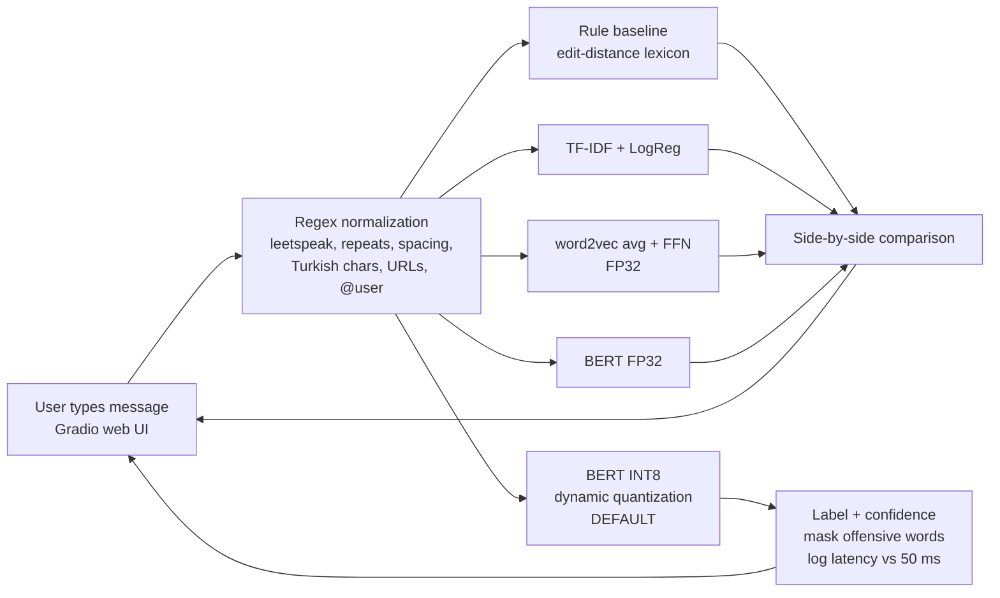

# Real-Time Chat Moderation (SWE015 – Use Case 4)

A gaming-chat moderator that labels every message **clean / offensive** live on a CPU,
masks offensive messages, and logs the response time of every message.
Four models of increasing sophistication are compared on the same held-out test set:

| # | Model | Technique area |
|---|---|---|
| 0 | Rule baseline: regex normalization + edit-distance lexicon matcher | B – Classical NLP |
| 1 | TF-IDF (uni+bigrams) + logistic regression (classical baseline) | B – Classical NLP |
| 2 | Our own word2vec (skip-gram, trained on the training tweets) + feedforward network (SGD + backprop) | A – Neural networks |
| 3 | BERT (`bert-base-uncased`) fine-tuned for classification | C – Transformers |
| 4 | Same BERT, dynamic INT8 quantization (PyTorch), latency budget 50 ms/message on CPU | D – Efficient models |

The application runs the **quantized BERT** by default; the other models can be selected or compared side by side.

## Setup

Requires **Python 3.10 – 3.12**.

```bash
git clone https://github.com/felbakary82-sys/chat-moderation.git
cd chat-moderation
python -m venv .venv
# Windows: .venv\Scripts\activate      macOS/Linux: source .venv/bin/activate
pip install -r requirements.txt
```

Train all models (downloads the data and `bert-base-uncased` automatically; BERT takes ~10 min on a GPU, ~2 h on a laptop CPU):

```bash
python train_all.py
```

On Windows you can instead double-click **`RUN_WINDOWS.bat`**: it creates the environment, installs the requirements, trains (first time only) and starts the app.
Trained weights are not stored in this repository (too large). If they are shared on Google Drive, set `DRIVE_FILE_ID` in `config.py` and run `python download_models.py` instead of training.

## Run

```bash
python app.py
```

Open http://127.0.0.1:7860. Add `--share` to get a public link anyone can try.

To re-create the results table: `python evaluate.py` → `results/results.md`.

## Results (held-out test set, 860 messages)

Measured on a Windows 11 laptop, Intel CPU (8 logical cores), PyTorch 2.8 CPU (4 threads), no GPU. Full table: [`results/results.md`](results/results.md).

| Model | Macro-F1 | Size (MB) | Latency mean (ms) | ≤ 50 ms |
|---|---|---|---|---|
| Rule (regex + edit distance) | 0.701 | 0.001 | 0.04 | yes |
| TF-IDF + LogReg | 0.729 | 0.985 | 0.52 | yes |
| Word2Vec + FFN | 0.676 | 3.595 | 0.20 | yes |
| BERT FP32 | 0.805 | 437.959 | 79.47 | no |
| BERT INT8 (quantized, used in app) | 0.776 | 181.495 | 23.39 | yes |

## Architecture



Everything runs locally on CPU (`app.py`, Python process). Training of BERT can use a GPU.

## Project structure

```
config.py               all settings (paths, hyper-parameters, latency budget)
prepare_data.py         step 1: download dataset -> data/*.csv
train_baselines.py      step 2: rule baseline + TF-IDF/LogReg
train_word2vec_ffn.py   step 3: own word2vec + feedforward network
train_bert.py           step 4: fine-tune BERT
quantize_bert.py        step 5: INT8 dynamic quantization
evaluate.py             step 6: all models on the same test set -> results/
app.py                  the application (Gradio)
moderation/             shared code: normalize.py, lexicon.py, neural.py, models.py
```

## Data and sources

- **OLID / OffensEval 2019** (English tweets, offensive vs. not offensive): Zampieri et al.,
  *Predicting the Type and Target of Offensive Posts in Social Media*, NAACL 2019.
  Loaded from the **TweetEval** benchmark on Hugging Face (`cardiffnlp/tweet_eval`, config `offensive`):
  Barbieri et al., *TweetEval*, Findings of EMNLP 2020. Splits: train / validation / test (official).
- **BERT**: Devlin et al., 2019, `bert-base-uncased` from Hugging Face.
- **word2vec**: Mikolov et al., 2013 (implemented from scratch in `moderation/neural.py`).
- Offensive lexicon (`moderation/offensive_lexicon.txt`): a short word list written for this project (with AI assistance).

## AI usage

Claude (Anthropic) was used to help write the code, debug it and draft the slides.
All results were produced by running the code in this repository.
